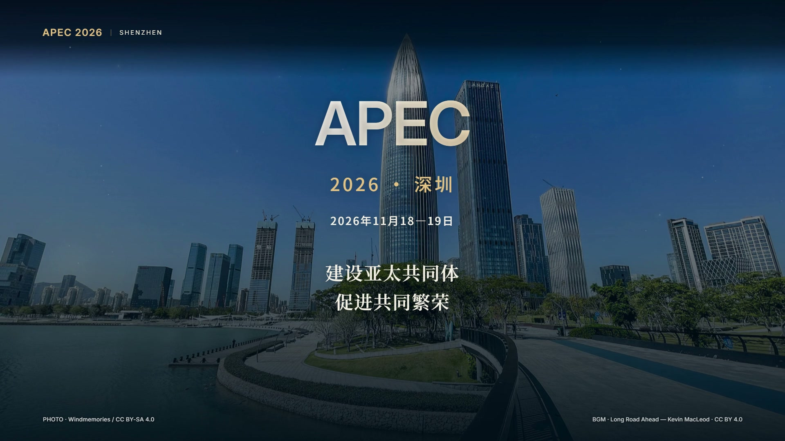

# cinematic-promo-video

从一个主题开始策划，或把用户提供的照片、视频、录音与可控代码动画组合成宣传短片的 Codex Skill。默认逐关引导，从需求、文案到分镜、样片和成片；支持用户明确授权后自动推进。版本：1.3.0。

**只给主题也可以。** 不需要先有素材、卖点或脚本；Skill先拟表达方向，协助确认需求，再过文案，随后检索适用素材、提出声音与视觉方案。有素材直接剪，素材不全按需补充。

## 已完成案例

[](examples/shenzhen-apec/final.mp4)

[深圳APEC《从深圳连接亚太》](examples/shenzhen-apec/README.md)：45秒、1080P横屏、真实照片动态呈现、中文配音、管弦乐与代码光效。包含最终成片、封面、关键画面、字幕、镜头表和素材署名。

## 适合做什么

城市文旅、企业品牌、产品发布、会议活动、项目成果、课程招募，以及这些短片的剪辑与包装。通常30—90秒，支持横屏、竖屏和方形。可以直接剪用户视频，保留原声，混用照片、录音、音乐与字幕；不要求生成图片或购买配音服务。

完整长访谈、长纪录片、长课程、剧情拍摄与纯转录不作为本技能主流程。可以从长素材中抽取可核实的片段制作独立宣传/预告。详见[适用条件](references/scope-and-inputs.md)和[用户素材剪辑](references/user-media-editing.md)。

## 怎么用

这是技能源码，不是桌面剪辑软件，也不是单命令自动成片工具。入口为[SKILL.md](SKILL.md)。开发源码目录本身不会自动启用。

需要安装时，先检查项目级及个人技能目录是否存在同名副本；选择一个启用位置，避免多个活跃副本。项目级安装：在目标项目内建立`.agents/skills/cinematic-promo-video/`，把本仓库的SKILL.md、agents/、references/、scripts/和assets/放进去。不要复制.git/、outputs/或运行缓存；不要覆盖已有同名技能。无需修改插件缓存或全局环境。

安装后可以这样发起：

> 使用 $cinematic-promo-video，主题是深圳城市形象，我没有素材，请先帮我拟方向，再从需求卡开始逐关引导。

也可以提供素材：

> 使用 $cinematic-promo-video，把我提供的12段视频、照片和录音剪成45秒横屏品牌宣传片。逐关引导，先确认需求和文案，再过分镜与样片，最后交付MP4和工程。

默认关卡：

1. 需求：主题、受众、时长、画幅、风格、素材和声音方式
2. 文案：完整口播或屏幕文字，以及预计节奏
3. 分镜与素材：逐镜时间、素材预览、取段、声音方案和缺项
4. 关键画面与样片：关键帧和有代表性的短片段
5. 成片：整片审阅、局部修改、验收和工程交付

每关给出可审阅内容，再等待明确通过；带修改的认可仍待修订。已通过关卡沿用，已有短片的局部修订直接处理相关部分。详见[关卡规则](references/guided-stages.md)。

## 主线、补充镜头与编辑预览

分镜先安排主线信息，再用B-roll展示操作细节、情境和结果证据，图形包装另记G；不机械规定A/B比例。纯旁白片保留主线音轨，核心录屏也可承担A-roll，不强加真人。详见[A-roll/B-roll指南](references/a-roll-b-roll.md)。

样片工程可运行、以及成片交付时，默认调用附带启动器自动打开“原生编辑器＋本地留言栏”，可改声明过的文字与参数、保存时间/对象留言，并由Agent读取处理、回复完成。无需每条片子重新写看板；不附带一套独立视频剪辑软件。

```sh
python "/absolute/path/to/skill/scripts/editor.py" open "/absolute/path/to/video-project" --engine hyperframes
```

需要Python 3.10+和视频项目已有的引擎依赖。文字和参数由原生编辑器保存；HyperFrames预览值要点击Set default，Remotion按Props保存要求处理。留言不会自动唤醒已结束的聊天，返回聊天说“处理看板留言”即可继续。详见[启动与留言命令](references/editor-runtime.md)、[看板机制](references/editing-dashboard.md)和[可运行示例](examples/editor-demo/README.md)。Remotion选中对象目前需手动填写，界面路线尚未端到端实测。

普通配音以自然清晰为目标；临时配音不因样片整体获认可就成为最终声音，正式声线在样片关试听确认。用户叫停视频时停止制作，Skill维护不恢复渲染。

## 用到哪些东西

| 路线 | 依赖 |
| --- | --- |
| 代码画面与预览 | 一个主要引擎：HyperFrames或Remotion；匹配版本的Node、项目锁定依赖与浏览器 |
| 视频剪辑与导出 | 可用素材、字体和所需音轨；按项目需要使用FFmpeg取段、转码与混音 |
| 附带文件检查器 | Python标准库、ffprobe；响度检查另需ffmpeg |
| 自动打开看板与本地留言 | Python 3.10+标准库、项目自己的引擎CLI；复用原生编辑器，不需要模型API或FFmpeg才能留言 |
| 按需选用 | GSAP、Canvas、语音识别/对齐、TTS、图像生成、云渲染 |

只有使用相应外部服务才需要账号、联网和凭据；完整本地依赖与素材可支持离线制作。详细用途、前置条件与缺项处理见[工具与依赖](references/toolchain.md)。视频项目各自管理依赖与素材，不在技能目录中安装共用媒体环境。

HyperFrames路线已在实际45秒项目中完成整片导出；Remotion路线目前为文档核对方案，未在该项目端到端实测。新项目仍需检查自己的版本、字体、音轨与样片。

## 检查命令

以下命令在本仓库根目录执行，先保证python和ffprobe可用。查看参数：

```sh
python scripts/check_delivery.py --help
```

检查实际视频时按规格填写参数；不带字幕则省略--srt，允许句末标点则省略--no-terminal-punctuation：

```sh
python scripts/check_delivery.py "/absolute/path/final.mp4" --width 1920 --height 1080 --fps 30 --duration 45 --srt "/absolute/path/captions.srt" --no-terminal-punctuation --loudness --report "/absolute/path/qa.json"
```

报告路径必须尚不存在。脚本检测文件规格、SRT和可选响度；不判断字体、画面质量、素材真假，也不能替代观看和试听。检查不通过会以非零状态退出。

## 仓库与素材边界

核心技能只包含说明、参考资料、UI元数据与检查脚本。examples/额外收录用户明确要求展示的已完成案例及其必要署名，不会自动纳入未来用户的素材。用户原片、独立录音、商业音乐、凭据与完整视频项目不默认上传。原件保留，派生文件与取段记录留在各自视频项目。Git提交不代表取得素材或字体的再分发许可。

outputs/与.tmp/不入库。历史验证报告与核心技能ZIP保留在本地outputs/，可从Git源码重新打包；ZIP不包含大体积案例媒体、编辑示例依赖或测试缓存。安装核心文件时也要包含assets/，否则留言界面无法加载。仓库同步不会自动安装Skill；案例成片仅按本次明确要求展示。

维护者在仓库根目录执行`python -X utf8 -m unittest discover -s tests -v`检查留言持久化、输入错误、HTTP接口、项目隔离、路径与原子保存。实际原生编辑器的界面与保存仍需独立示例验证，单元测试不能代替它。
