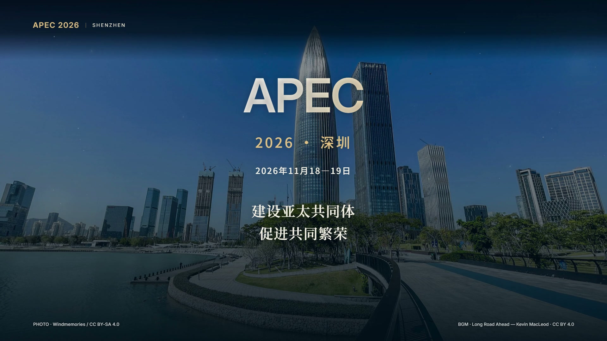

# 深圳APEC：从深圳连接亚太

已完成的主题起步案例，由用户要求收录展示。署名：**@鱼鳞今天AI了吗 · AI Coding大赏**。

[查看/下载最终成片](final.mp4) · [关键画面](keyframes.jpg) · [字幕](captions.srt) · [镜头表](film-plan.json) · [素材与音乐署名](CREDITS.txt)

GitHub不能直接播放仓库中的MP4时，可在文件页使用下载按钮观看；封面和关键画面可直接预览。

## 任务与结果

最初需求是制作一条深圳APEC宣传短片，60秒以内，横屏用于抖音，整体大气，并希望包含配音。用户从主题和风格开始，逐步审阅文字、画面和声音，没有要求先交完整素材包。

最终为1920×1080、30fps、45秒H.264/AAC成片，含片尾署名。画面采用有来源的真实照片，通过推拉、裁切、转场、排版与代码光效形成动态呈现；这不是连续实拍视频，也没有使用本届会议现场画面。研发、制造镜头是通用行业摄影，不代表某家深圳企业的现场。

## 怎样制作

1. 明确平台、受众、画幅与气势，确定宣传主线，再逐步确认文案与脚本。
2. 按镜头需要取得摄影素材并记录作者、来源、许可与改动；生成或示意画面不能冒充真实地点。这个案例后续按用户要求统一为真实摄影。
3. 安排中文旁白、逐句时间点与配乐，压缩空白并适当加快语速，将片长浓缩到45秒。配乐与人声混音，结尾自然收束。
4. 根据主体改变左右/居中构图，优化中文字体与层级，去掉字幕句末标点；添加粒子、光晕、扫光与转场音效，避免覆盖主体和文字。
5. 从原有工程迁移到HyperFrames 0.9.28，使用16个原生镜头、共享帧表与确定性动画。先验证短片段、中文、直接跳帧与音轨，再渲染整片。
6. 检查成片的规格、字幕、音轨与关键画面，交付后将其中可复用的判断规则提炼为本Skill。Remotion是另一路线方案，本案例实际使用HyperFrames。

这段记录描述真实项目的制作与迭代，不表示历史项目已经运行过后续提炼的1.1.1版Skill。新的逐关流程用于以后复用：需求 → 文案 → 分镜与素材 → 关键画面与样片 → 成片。

## 本目录能提供什么

收录的是最终v6成片的原文件、封面、关键画面、字幕、镜头表和完整原署名说明，没有重新编码或重渲染。镜头表中的素材文件名来自原视频工程，仅用于展示分镜结构；本目录不包含全部媒体、字体、代码与依赖，不能直接当作完整可渲染工程。

核心技能及引擎操作规则见[SKILL.md](../../SKILL.md)、[HyperFrames路线](../../references/hyperframes.md)和[制作流程](../../references/workflow.md)。素材、声音与时间参数属于这个案例，不是所有宣传片的固定模板。

## 来源与许可

原项目声明：视觉改编按CC BY-SA 4.0提供；音乐为Kevin MacLeod的Long Road Ahead，按CC BY 4.0提供。具体摄影作者、来源页、修改及许可证见[CREDITS.txt](CREDITS.txt)。本目录保留既有署名，不把第三方素材声明为仓库作者原创。原署名中提及的assets/fonts指原可编辑工程的字体目录，本展示目录不分发字体文件。

片中会议信息和来源反映该成片制作时的核对结果；以后复用文案应重新核实日期、主题与举办信息。片尾账号和活动名仅属于本案例，不默认加入其他用户视频。
